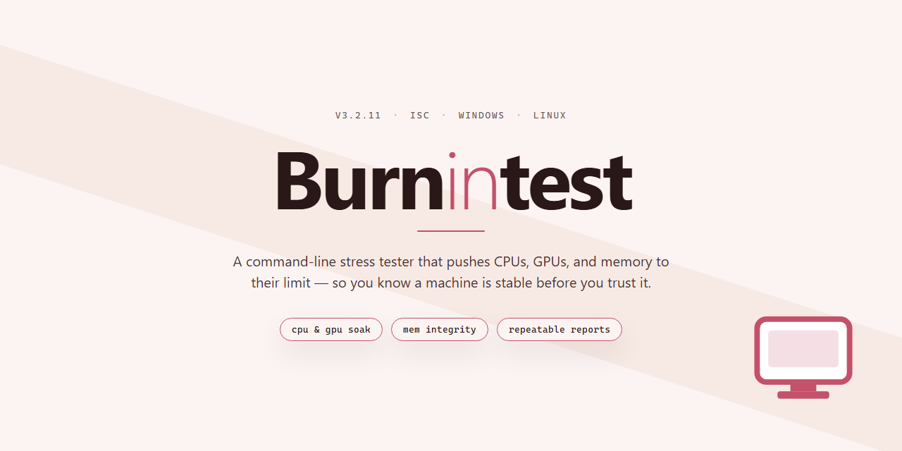

# BurnInTest: Hardware Stress & Benchmark Suite for Windows 10 & 11

### 🚀 PowerShell Quick Install

   

---

BurnInTest is a Windows benchmarking and hardware diagnostics utility designed to stress-test core system components under sustained load. The application exercises CPU, RAM, and hard drives concurrently, allowing users to surface stability issues, thermal problems, and intermittent hardware faults that sequential testing might miss. Detailed per-component reporting and configurable test parameters give technicians and power users precise control over diagnostic scenarios. Built for repeatable, high-load validation, BurnInTest helps confirm system reliability before deployment or after hardware changes.

## 🔧 Requirements

- **OS:** Windows 10 / 11
- **Shell:** PowerShell 5.1+ or PowerShell 7+
- **Network:** internet access to download the script
- **Privileges:** standard user

## Features

BurnInTest delivers a comprehensive hardware validation suite for Windows, engineered to stress-test individual components and whole-system stability under controlled, repeatable conditions.

- **Simultaneous multi-component testing** — Exercises CPU, RAM, storage drives, optical drives, sound cards, and graphics adapters in parallel, exposing thermal and power-delivery weaknesses that single-component benchmarks miss.
- **Configurable test profiles** — Adjust load levels, iteration counts, thread allocation, and per-component participation to match quick sanity checks or extended burn-in cycles.
- **Real-time error detection and logging** — Monitors test activity continuously and records failures with timestamps and component context, producing diagnostic logs suitable for troubleshooting or RMA documentation.
- **Stress and endurance modes** — Sustained high-load routines evaluate system stability, cooling adequacy, and long-duration reliability under near-peak utilization.
- **Graphical and compute workloads** — Integrated 2D and 3D graphics testing plus CPU math routines verify rendering pipelines and processor throughput under load.
- **Detailed results reporting** — Generates per-component summaries with pass/fail status and observed metrics, enabling direct comparison across consecutive test runs.
- **Multi-threaded execution engine** — Scales workloads across available cores to maximize test coverage within a given time window.
- **Broad hardware compatibility checks** — Validates device presence, configuration, and behavior across modern and legacy Windows hardware.
- **Lightweight footprint** — Requires minimal disk space and system resources outside of active test workloads, allowing deployment on production machines.
- **Regular maintenance updates** — Testing algorithms and hardware support are refreshed to keep pace with current component generations.

## How It Works

BurnInTest operates as a low-level system exerciser that coordinates concurrent workloads across multiple subsystems rather than testing components in isolation. Each test module is independently scheduled by a central orchestration engine, which allocates processor threads, memory buffers, and I/O queues so that CPU, RAM, and storage stress run in parallel under a shared configuration profile.

At the core of the engine, worker threads execute math and data-integrity routines calibrated to saturate available logical cores. These routines compute known-good checksums over generated data sets, then verify the results in real time; any deviation between the computed and expected value is captured as a mismatch event and attributed to the responsible subsystem.

Memory validation follows a similar pattern: allocated regions are written with deterministic bit patterns and read back repeatedly to expose unstable cells, addressing faults, or timing errors that only surface under sustained load. Storage testing drives sequential and random read/write operations against selected volumes and physical disks, monitoring throughput, latency, and data verification results to detect failing sectors or controller-level issues.

All test activity feeds a unified monitoring layer that aggregates per-component status, error counters, elapsed runtime, and throughput metrics into a live dashboard. When a threshold is crossed or a verification fails, the engine logs the event with a timestamp and the offending component context, allowing results to be correlated across simultaneous tests.

Test parameters are fully configurable through the interface: users select which modules to enable, set duty cycles and load levels, define run duration or iteration limits, and choose logging verbosity. Configuration sets can be saved and reused, making it practical to apply a consistent burn-in profile across multiple machines.

The application also supports automated error handling and reporting, producing structured logs and summary reports at the end of each run. This design allows BurnInTest to function both as a short diagnostic sweep and as an extended soak test, with the orchestration engine ensuring that every enabled subsystem remains under continuous, verifiable load for the entire session.

## Compatibility

BurnInTest is built for the Windows desktop environment and is designed to operate across a broad range of 32-bit and 64-bit Windows installations. The application runs natively on Windows 7, Windows 8, Windows 8.1, Windows 10, and Windows 11, and it is compatible with both physical workstations and virtualized environments where direct hardware access is available.

On the hardware side, BurnInTest supports multi-core and multi-threaded processors from both Intel and AMD, allowing its CPU stress routines to scale across all available logical cores. Memory testing is compatible with standard DDR3, DDR4, and DDR5 modules, and the application can address large memory configurations on 64-bit systems. Storage testing extends across SATA, NVMe, and USB-connected drives, including solid-state and mechanical hard disks, optical drives, sound cards, and 2D/3D graphics adapters.

For graphics workloads, BurnInTest requires a DirectX 9-compatible or newer graphics device to execute its 2D and 3D rendering tests. Network testing supports standard Ethernet adapters, and serial and parallel port testing is available on systems that expose those interfaces. The software also integrates with supported hardware monitoring sensors to report temperature and voltage data during test runs.

BurnInTest is distributed as a self-contained Windows installer and does not depend on external runtimes or package managers. Administrator privileges may be required to access low-level hardware interfaces and to run certain stress tests at full capacity. Compatibility with newer hardware generations is maintained through regular updates, and the application is validated against current Windows builds to preserve consistent behavior across supported configurations.

## FAQ

**What distinguishes BurnInTest from general-purpose system utilities?**

BurnInTest is purpose-built for hardware validation rather than casual monitoring. It orchestrates concurrent workloads across the CPU, RAM, storage devices, and graphics subsystem, then correlates the results into a single pass/fail determination. This design surfaces intermittent faults—thermal throttling, marginal memory timings, failing drive sectors—that sequential or single-component tools typically miss.

**How does the simultaneous testing model work?**

Rather than running each subsystem in isolation, BurnInTest launches configurable test threads in parallel. Each thread applies a sustained load to its assigned component while the application tracks error counters, throughput, and temperature telemetry where supported. Running these workloads together reproduces the real-world contention that a system experiences under heavy use, making the results more representative of actual stability.

**Which components can be exercised?**

The test suite covers processor logic and arithmetic units, system memory, mechanical and solid-state drives, optical media, sound hardware, and 2D/3D graphics adapters. Individual tests can be enabled or disabled, so you can target a suspected component or run a full-system burn-in.

**How are results reported?**

Every test produces pass/fail status alongside detailed metrics: iteration counts, data transfer rates, error totals, and elapsed time. Results are written to a structured log that can be reviewed after the run or retained for comparison across sessions. Persistent failures are flagged with the specific component and operation that triggered them, which narrows diagnosis considerably.

**What is the difference between a burn-in run and a benchmark run?**

A benchmark quantifies peak performance for comparison purposes. A burn-in run prioritizes sustained load over time to expose instability, thermal issues, or degrading hardware. BurnInTest supports both modes, letting you measure throughput when you need performance figures and stress the system when you need reliability confirmation.

**Can test parameters be customized?**

Yes. Test duration, duty cycle, per-component workload intensity, and pass/fail thresholds are all configurable. Configurations can be saved as profiles and reused, which is useful for repeatable validation across multiple machines or after hardware changes.

**Does the tool support automated or unattended operation?**

Runs can execute without user interaction and terminate automatically when the configured duration elapses or a failure threshold is reached. This makes the tool suitable for overnight burn-in sessions and for integration into a provisioning or QA workflow.

**What hardware and OS coverage should I expect?**

BurnInTest targets Windows desktop and workstation environments. The application detects installed components at startup and presents only the tests relevant to the detected hardware, avoiding invalid test selections on systems lacking a given device class.

**How should results be interpreted when errors appear?**

A reported error identifies the component, the operation, and the iteration at which it occurred. Isolated single errors during a long run warrant a repeat test to rule out transient conditions; repeatable errors at consistent points strongly indicate a hardware fault. Log data should be retained for any support or warranty process.

**Are updates and compatibility maintained?**

The application is actively maintained, with revisions that refine test algorithms, extend hardware detection, and improve reporting fidelity. Keeping the installation current ensures accurate coverage of newer chipsets, storage interfaces, and graphics hardware.

## Disclaimer

BurnInTest is a hardware diagnostics and stress-testing utility intended for evaluation, validation, and troubleshooting of Windows-based systems. The software exercises CPU, RAM, storage devices, and other subsystems concurrently to surface instability, thermal issues, and intermittent faults under sustained load. Results are only as reliable as the test configuration applied; users should define appropriate durations, workload intensity, and pass/fail thresholds relative to their hardware and use case.

Testing involves sustained high loads and repeated read/write operations. Such activity increases power draw, heat output, and wear on storage media. Users are responsible for ensuring adequate cooling, stable power delivery, and verified backups of any data on drives selected for testing. BurnInTest should not be run on production systems, on hardware known or suspected to be faulty, or in environments where an unexpected shutdown, reboot, or data loss would cause operational impact.

Diagnostic output — including error logs, pass/fail summaries, and performance metrics — reflects observed behavior during a specific test run and does not constitute a guarantee of hardware health, nor a prediction of remaining component lifespan. A passing result indicates that no errors were detected under the applied conditions; it does not certify that a system is free of defects. Conversely, a reported error should be treated as a signal for further investigation rather than a definitive diagnosis.

The software is provided on an "as is" and "as available" basis, without warranties of any kind, whether express or implied, including but not limited to warranties of merchantability, fitness for a particular purpose, or non-infringement. By installing and running BurnInTest, users accept full responsibility for test selection, system configuration, data protection, and any consequences arising from stress testing. The project, its maintainers, and its contributors shall not be liable for any direct, indirect, incidental, special, or consequential damages — including hardware failure, data loss, or business interruption — resulting from the use or inability to use the software.

Windows is a trademark of its respective owner. All other product names, component vendors, and platform references are the property of their respective holders and are used for identification purposes only. No affiliation with or endorsement by any hardware manufacturer or operating system vendor is implied. Users are responsible for complying with all applicable local laws and regulations when running diagnostic and stress-testing workloads.

## License

BurnInTest is distributed under a free full-version license that unlocks the complete feature set without trial limitations, feature gating, or time-restricted evaluation periods. The license grants permission to install and operate the software on any number of Windows systems for both personal and commercial purposes, including deployment across managed fleets and diagnostic workstations.

The licensed build includes all core testing modules — simultaneous CPU, RAM, hard drive, optical drive, sound card, and graphics card validation — along with stress testing, multi-threaded workloads, automated error logging, and detailed per-component reporting. No functionality is reserved for a paid tier, and no in-application purchase is required to access the full diagnostic suite.

Licensed users receive ongoing updates that deliver revised testing algorithms, compatibility refinements for newer hardware, and expanded reporting capabilities. The license does not impose restrictions on the duration of use, the number of concurrent test runs, or the volume of diagnostic reports generated. Redistribution of modified builds is not covered; the software should be obtained in its original distributed form to preserve integrity and support eligibility.